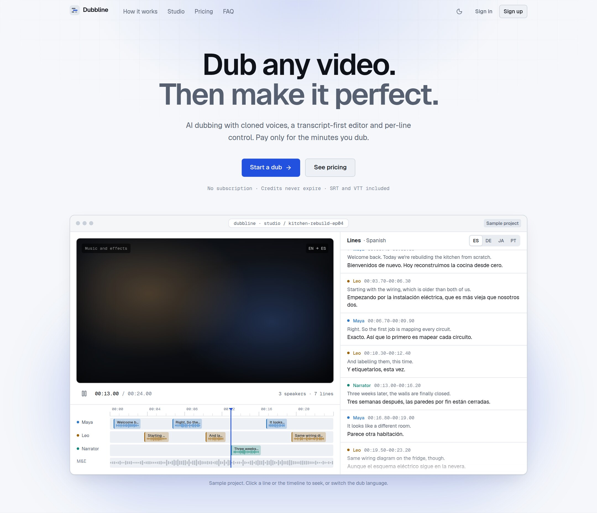
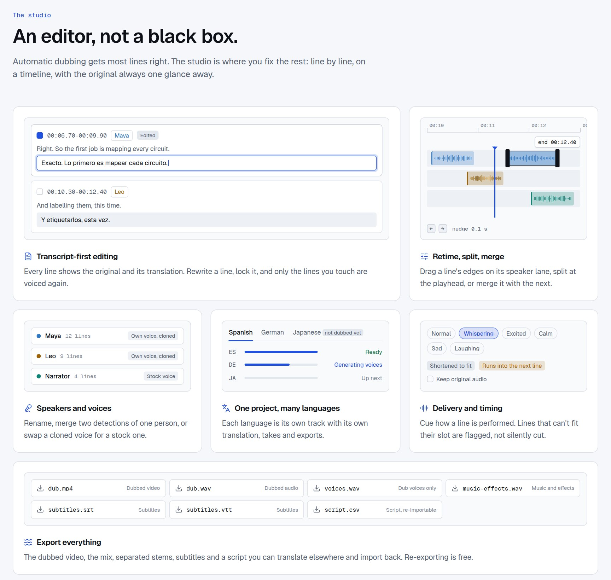

# Dubbline

**Dub any video. Then make it perfect.**

AI video dubbing with cloned voices, a transcript-first editor and per-line control.

[Product tour](docs/product.md) · [How it's built](docs/architecture.md) · [Quality](docs/quality.md)

<picture>
  <source media="(prefers-color-scheme: dark)" srcset="assets/studio-dark.jpg">
  
</picture>

> **About this repository.** Dubbline is a commercial SaaS, so the source code is private and the product is in active development. This repository is the public showcase: what it does, how it works, and how it is engineered. The screenshots are from the product's own sample project. For a demo or a similar build, see [Work with me](#work-with-me).

## What it does

Upload a video, pick one or more languages, and Dubbline returns it voiced in each language with **clones of the original speakers**. Then you can fix anything: edit a line, retime it, change who speaks it, and regenerate only what you touched.

- **A cloned voice per speaker.** Speakers are detected automatically and each keeps their own voice, or can be given a stock voice.
- **A transcript-first editor.** Every line shows the original next to its translation, on a timeline with one lane per speaker and real waveforms.
- **Edits are free; only re-voicing costs credits.** Rewrite or lock a line and only the lines you touch are voiced again.
- **Many languages from one project.** Each language is its own track with its own translation, takes and export, reusing the prepared lines and voices.
- **Speech is never cut off.** Lines that don't fit their slot are shortened, sped up slightly, or flagged for you, never silently truncated.
- **Music and effects are kept.** Voices are separated from the background, and only the voices are replaced.
- **Export everything.** Dubbed video, mixed audio, dub voices alone, separated stems, SRT/VTT subtitles, and a script CSV that can be translated elsewhere and imported back.
- **Agent-ready.** A public API, API keys, a command-line client and an MCP server let AI agents quote, run and download dubs, but only a person can pay.

<picture>
  <source media="(prefers-color-scheme: dark)" srcset="assets/features-dark.jpg">
  
</picture>

## How a dub is made

The first five stages run once per project; the rest run per language. Details in [docs/architecture.md](docs/architecture.md).

## Engineering highlights

| Problem | What I built |
| --- | --- |
| Dubbed lines often don't fit the time the original line took | **Translation with a time budget** per line, then a fit loop: shorten the text, speed the take up slightly, and flag whatever still overruns. Speech is never truncated. |
| Paying twice for the same voice take | **Content-addressed take cache.** Re-running, retrying after a failure or re-rendering never regenerates an identical take. |
| Jobs that take minutes must survive crashes and double-clicks | **Database-backed queue** with leases and heartbeats, a reaper for stale runs, and a database constraint that allows only one active run per project, so two requests can't both start and charge. |
| Users pay per minute, so money bugs are expensive | An **append-only credit ledger**, refunds for unfinished work, and a clean split between **quote** and **spend** across the web app, API, CLI and MCP tools. |
| Let users edit without breaking the pipeline | Every edit is validated and revision-checked, and marks only the **affected stages stale**, so a retime re-runs fit and mix but not translation. |
| Judging whether a change made dubs better | A **quality bench** that scores speaker accuracy, timing overruns and round-trip transcription error on fixed reference clips. See [docs/quality.md](docs/quality.md). |

## Tech stack

`Python` · `FastAPI` · `PostgreSQL` · `SQLAlchemy` · `Alembic` · `Next.js` · `TypeScript` · `ffmpeg` · `Docker` · `Stripe` · object storage with signed URLs · speech-to-text, LLM translation and voice-synthesis providers behind small adapter interfaces

## Work with me

I build end-to-end products with media and AI pipelines, background jobs, billing, and polished interfaces. If that sounds useful:

- X: [@LinkyDevv](https://x.com/LinkyDevv)
- GitHub: [bulgadev](https://github.com/bulgadev)

## License

All rights reserved. The source code is private. The text and screenshots in this repository may not be reused without permission.
