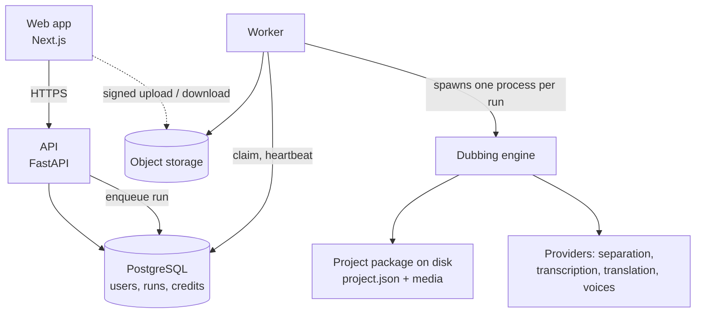

# Dubbline: how it's built

A high-level tour of the design. The source code is private, so this page covers architecture and decisions rather than code.

## Shape of the system

A **modular monolith**: one Python codebase with two process types (an API and a worker), plus a Next.js web app. There are no microservices.

- **Engine.** A standalone package that turns a video into a dubbed video. It knows nothing about users, billing or HTTP. It reads a run request, writes a project package, and emits progress events.
- **API.** Authentication, projects, edits, credits, billing and signed media URLs.
- **Worker.** Claims queued runs from the database, starts the engine as a child process, reads its progress events, and publishes exports.

## The engine: stages and project package

Each project is a folder with a single `project.json` (settings, speakers, lines, one track per language, stage states and a revision) plus the media. Writes are atomic under a file lock, with recent versions kept.

Eleven stages run in two scopes:

| Scope | Stages |
| --- | --- |
| Once per project | extract audio, separate voices from music and effects, transcribe with speaker labels, segment into lines, pick voice samples per speaker |
| Once per language | translate, synthesize, fit, mix, render, quality report |

Completing a stage marks the later stages of its scope **stale**, which is what makes cheap, targeted re-runs possible.

### Segmentation

A line is one speaker's sentence or phrase. A new line starts when the speaker changes, after a long pause, at sentence ends once a line is long enough, and at commas or hard limits for very long lines. Fragments that are too short join a neighbour.

### Timing: the fit loop

Dubbed speech has to fit the time the original line occupied. Each line may use its own time plus the silence after it.

1. **Translate to a budget.** The translator gets a per-line character budget derived from the line's window and the target language's speaking rate.
2. **Shorten.** After voicing, takes that run too long go back to the translator for a shorter rewrite and are voiced again, bounded so cost can't spiral. Text the user wrote is never rewritten.
3. **Fit.** A take that fits plays at normal speed; a slightly long one is sped up within a small limit; anything still over is flagged as an overrun in the editor.

Speech is never truncated and takes are never slowed down.

### The take cache

A voiced take is keyed by a hash of the model, the voice samples, the text with its delivery cues, and a seed. Re-running, retrying after a failure or re-rendering never pays for the same take twice. Only an explicit "regenerate" changes the seed.

### Editing without re-running everything

Every user edit goes through one module that validates it against the project revision, never calls a provider, and marks only the work it affects as stale:

| Edit | What it invalidates |
| --- | --- |
| Change a line's text or delivery | voicing for that language |
| Change a line's speaker | voicing in every language |
| Retime | fit in every language |
| Split a line | translation in every language |
| Merge lines | voicing |

Edited fields are tracked as the user's own, and regenerating never overwrites them unless explicitly asked.

## Reliability

- **Database-backed queue with leases.** A claim sets an owner; heartbeats only refresh a lease the worker still holds; only the holder may finish the run. A worker whose run was reclaimed by the reaper stops at its next heartbeat without publishing anything.
- **One active run per project**, enforced by a partial unique index, so two simultaneous requests can't both start (and charge for) a run.
- **Cancellation** signals the engine's process group within about two seconds. Writes are atomic and takes are cached, so a retry doesn't pay twice.
- **Retries with jittered backoff** on every remote provider call, for rate limits, timeouts and server errors.
- **Per-language outcomes.** If one language fails, the languages that completed still become ready and exportable, and only the unfinished ones are refunded.

## Money

- An **append-only credit ledger**, with Stripe Checkout for packs and single videos, webhook fulfilment, and refunds and disputes handled.
- Prices are quoted before anything is spent; a dub costing more than the balance is refused up front.
- Billing also runs in a **mock mode** for development and tests.

## Security boundaries

- Users never edit the project file directly. Settings pass through an allowlist that checks types, ranges and options, and providers are chosen by the server, never by a project.
- Every project, run and export lookup is scoped to the caller's workspace.
- Media is served through signed, expiring URLs, with path checks.
- Provider credentials exist only in the worker's environment, and the engine process receives only what it needs, never database, billing or auth secrets.
- Importing a video from a link only fetches public addresses over HTTPS, pins the connection to the checked address, validates redirects and caps the size. Source files are probed with a restricted container list so a crafted file can't make ffmpeg open other files.
- API keys are stored as hashes and are shown once. Keys cannot create or revoke keys.

## Testing

A Python test suite covers the engine, API, billing and security regressions; the web app has type checks, lint and browser end-to-end tests. A **demo engine** with offline stand-in providers runs every real stage (separation, segmentation, fit, mix, render) without calling any paid service, so the whole product can be clicked through locally and in tests.
